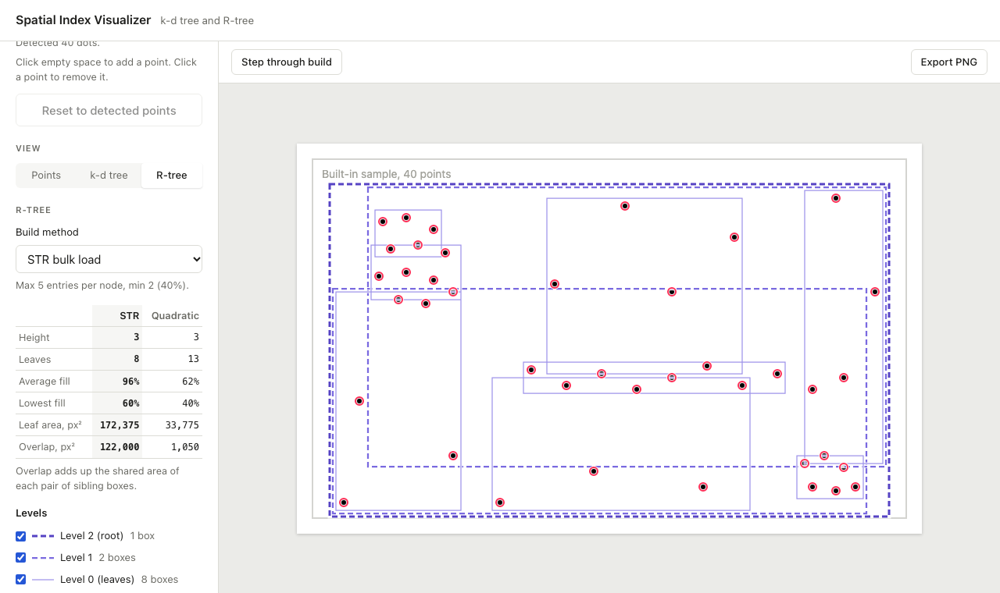
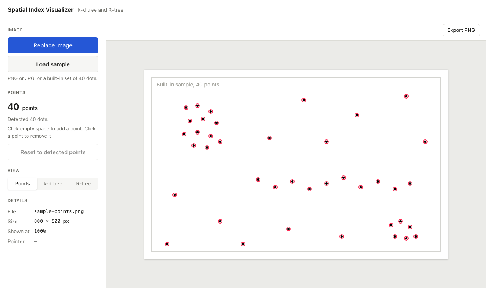
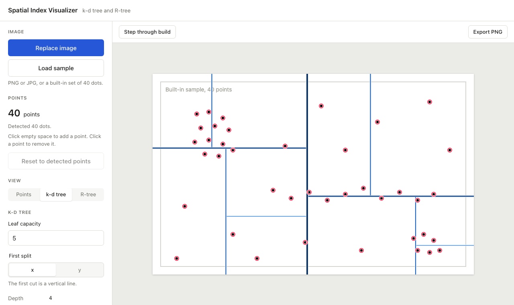
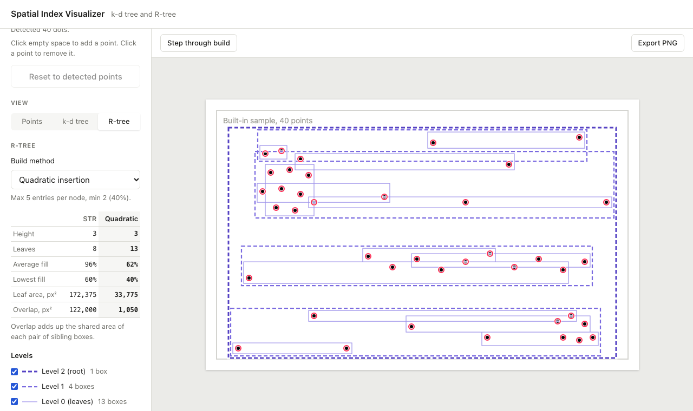
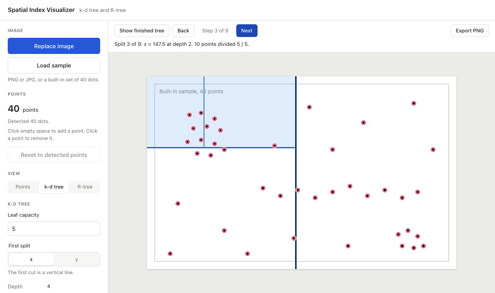
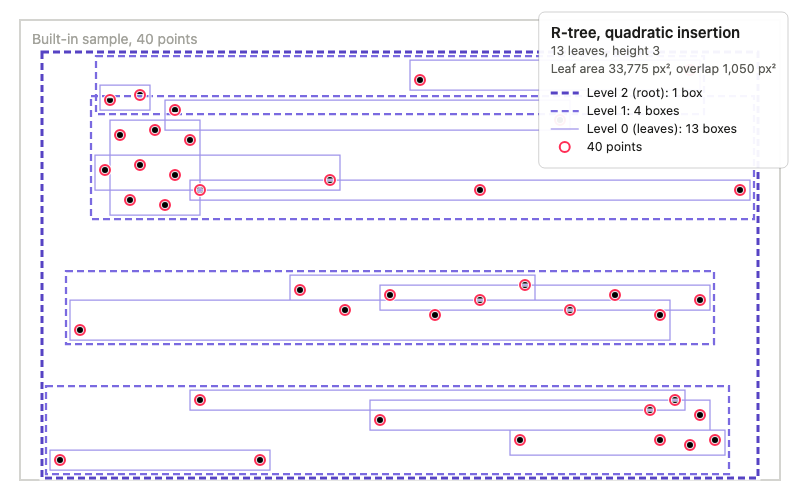

# Spatial Index Visualizer

A browser tool for seeing how two spatial indexes divide up the same set of 2D points:

- **k-d tree**: splits space with axis-aligned lines, alternating between x and y. Each split cuts a region in two at a point, so the regions never overlap and together cover the whole plane.
- **R-tree**: groups nearby points into bounding rectangles, then groups those rectangles into larger ones. The rectangles fit the data tightly but can overlap, and empty space is often left uncovered.

Upload an image with black dots on it (a map, a scan, a chart) or load the built-in sample. The app finds the dots, then draws either partition over them so you can compare the two.



## Run it locally

You need Node.js 20.19 or newer and [pnpm](https://pnpm.io). If `pnpm` is not installed, `npx pnpm <command>` works too.

```sh
pnpm install
pnpm dev          # http://localhost:5173
```

## Using the app

### 1. Load points

Click **Upload image** to choose a PNG or JPG, or **Load sample** to use a built-in image with 40 dots. The image is shown at its original size, or shrunk to fit the window if it is too big.

The app finds the dark dots and marks each one with a red ring. The sidebar shows how many it found, how many touching groups it split apart, and how many shapes it skipped (text, lines, borders).

Detection is not perfect, so you can fix it by hand: click empty space to add a point, or click a ring to remove it. **Reset to detected points** undoes your edits.



### 2. Draw a k-d tree

Under **View**, pick **k-d tree**.

- **Leaf capacity** (default 5): a region with this many points or fewer is not split further.
- **First split**: whether the first cut is a vertical line (x) or a horizontal one (y). Later levels alternate.

Each split line is drawn only across the region it divides. The top level is the darkest and thickest blue, and deeper levels are lighter and thinner. The sidebar lists the depth, the number of leaves, the points per leaf, and a legend of each level's axis.



### 3. Draw an R-tree and compare build methods

Under **View**, pick **R-tree**, then choose a **Build method**:

- **STR bulk load** sorts all points at once and packs nodes full.
- **Quadratic insertion** adds points one at a time and splits a node in two whenever it overflows.

Both use at most 5 entries per node and at least 2 in every node except the root. Leaf boxes are thin solid rectangles; higher levels are thicker dashed ones, each level in its own shade of violet. Use the checkboxes under **Levels** to show or hide a level.

The table builds both trees over the same points so you can compare them side by side:

| Row | Meaning |
|---|---|
| Height | Number of levels, leaves included |
| Leaves | Number of leaf boxes |
| Average fill, Lowest fill | How full the nodes are, as a share of the 5-entry maximum (the root is not counted) |
| Leaf area | Total area of all leaf boxes, in square pixels |
| Overlap | Total area shared by each pair of sibling boxes, in square pixels |

On the sample, STR packs nodes 96% full but its boxes are large and overlap a lot. Quadratic insertion uses more, emptier nodes with much tighter boxes:



### 4. Step through a build

In k-d tree or R-tree view, click **Step through build** above the image, then use **Next** and **Back**. A caption explains each step, and the area the step added is shaded.

- **k-d tree**: one split per step, in the order the algorithm makes them: a region, then everything on its lower side, then its upper side.
- **R-tree, STR**: one node per step. STR builds bottom-up, so all leaves come first, then each level above, then the root.
- **R-tree, quadratic insertion**: one point per step, because this method builds by inserting points. You can watch leaves fill up and split, and the tree grow a level when the root splits.

**Show finished tree** leaves step mode.



### 5. Export a PNG

**Export PNG** saves the image at its original resolution with exactly what is on screen: the current partition (including the current step and hidden levels), the point markers, and a legend. The legend goes in whichever corner covers the fewest points. On very large images the lines, markers and legend are scaled up so they stay readable.

The file is named after the image and view, for example `sample-points-rtree-quadratic.png`.



## How it works

### Coordinates

Image pixel coordinates are the single source of truth. `(0, 0)` is the image's top-left pixel and `(width, height)` is its bottom-right corner, at native resolution. The canvas transform maps image pixels to screen pixels, so all drawing uses image coordinates and lines up with the image at any zoom or screen density. Exports use the same drawing code at a 1:1 scale. See [`src/geometry/imageSpace.ts`](src/geometry/imageSpace.ts).

### Point detection

[`src/detection/detectPoints.ts`](src/detection/detectPoints.ts):

1. Each pixel is composited onto white (so transparent PNG backgrounds read as white) and counted as dark if its luminance is below 128.
2. Dark pixels are grouped into 8-connected blobs.
3. The typical dot area is the median area of blobs that are round and solid.
4. Blobs under 30% of that area are noise. Blobs over 3.5 times it (borders, large text) are ignored.
5. Dot-sized blobs must also be round and solid. The test compares a blob's area to the solid ellipse with the same second moments: a disc scores about 1, while letters, rings and strokes score lower or come out elongated. This matters because small text is often the same size as a dot.
6. Blobs about 2 or 3 dots in size are split with k-means, and the split is kept only if every piece passes the same shape test.

The thresholds are in `DEFAULT_DETECTION_OPTIONS`. Known limits: a dot touching a line or letter merges with it and is dropped, and colored or light gray dots are not detected. Add those by hand.

### k-d tree

[`src/trees/kdtree.ts`](src/trees/kdtree.ts) splits each node at the median. The split value is the midpoint between the two middle sorted values, so no line passes through a point. If the two middle values are equal, the split moves to the nearest place where values differ. If all of a node's points share one coordinate it splits on the other axis, and identical points stay together in one leaf.

### R-tree

[`src/trees/rtree.ts`](src/trees/rtree.ts) has both builders and an `analyzeRTree` helper for the stats.

- **STR** (Sort-Tile-Recursive) sorts by x into vertical slices, sorts each slice by y, and packs runs of 5. A short last run is evened out with its neighbor so no node falls below the minimum.
- **Quadratic insertion** follows Guttman: choose the leaf needing the least enlargement, and when a node overflows, seed two groups with the pair that would waste the most area together, then assign the rest one at a time. Points have no area, so ties fall back to perimeter.

### Colors

Both trees use a single-hue ramp because levels are ordered: blue for the k-d tree and violet for the R-tree, so neither is confused with the red point markers. Each ramp has five steps, checked for even lightness gaps and contrast on white. Levels past the fifth reuse the last step and differ only by line width.

## Development

```sh
pnpm test         # run the Vitest suite once
pnpm test:watch   # run Vitest in watch mode
pnpm lint         # ESLint
pnpm typecheck    # TypeScript (tsc -b)
pnpm build        # type-check and build to dist/
pnpm preview      # serve the production build
```

The detection, tree, step and legend logic are plain TypeScript modules with unit tests on small synthetic inputs. The tree tests check the structural rules on many point sets: every point in exactly one leaf, node sizes within limits, and parent boxes containing their children. `src/App.test.tsx` covers the main flows with React Testing Library.

### TypeScript versions

`tsc` is TypeScript 7, installed under the alias `@typescript/native`. TypeScript 7 has no JavaScript API yet, so the `typescript` package name is aliased to `@typescript/typescript6`, which typescript-eslint needs. This follows [Microsoft's side-by-side setup](https://devblogs.microsoft.com/typescript/announcing-typescript-7-0/#running-side-by-side-with-typescript-6.0). Once typescript-eslint supports TypeScript 7.1 or later, the alias can go.

### Project layout

```
src/
  App.tsx                    app state: image, points, view, trees, steps, export
  components/
    CanvasToolbar.tsx        step-through controls and Export PNG
    ImageCanvas.tsx          sizes the canvas, handles clicks and hover
    KdTreePanel.tsx          k-d settings, summary and legend
    RTreePanel.tsx           R-tree method, comparison table and level toggles
    Sidebar.tsx              upload, sample, point count and image details
    ViewModeSwitch.tsx       points, k-d tree or R-tree
  detection/detectPoints.ts  dot detection
  export/exportPng.ts        renders and downloads the PNG
  geometry/imageSpace.ts     coordinate conversions
  image/                     PNG/JPG validation, decoding and pixel reading
  points/editPoints.ts       click to add or remove a point
  render/
    drawScene.ts             draws image, overlays and markers (screen and export)
    kdTreeStyle.ts           k-d colors and widths
    legend.ts                legend content, corner choice and drawing
    rtreeStyle.ts            R-tree colors, widths, dashes and padding
  sample/sample.ts           the built-in 40-point sample
  settings/kdSettings.ts     k-d defaults and leaf capacity validation
  steps/buildSteps.ts        what to draw at each build step, with captions
  trees/kdtree.ts            k-d tree
  trees/rtree.ts             R-tree
docs/screenshots/            images used in this README
```
